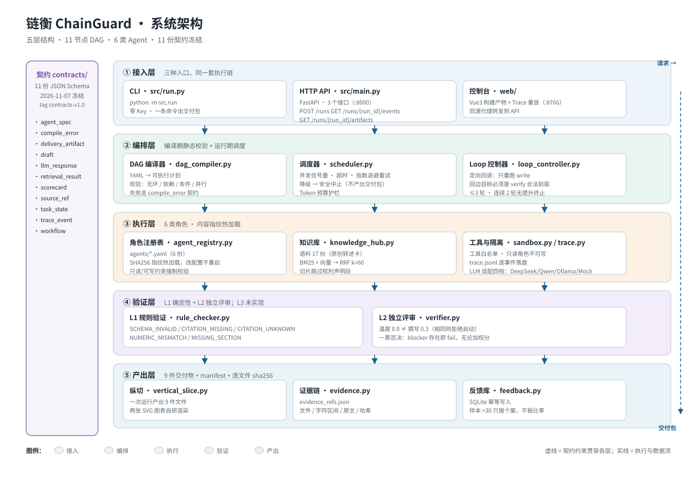
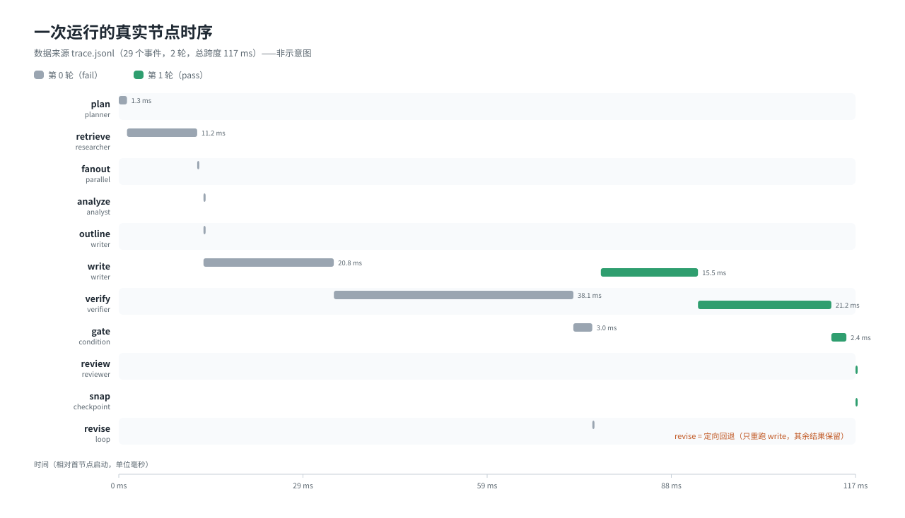
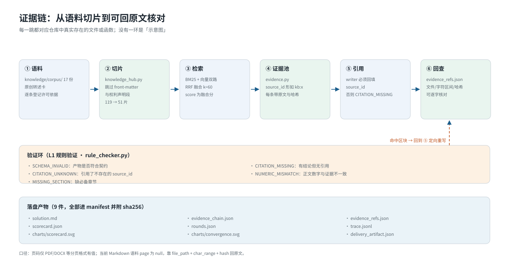
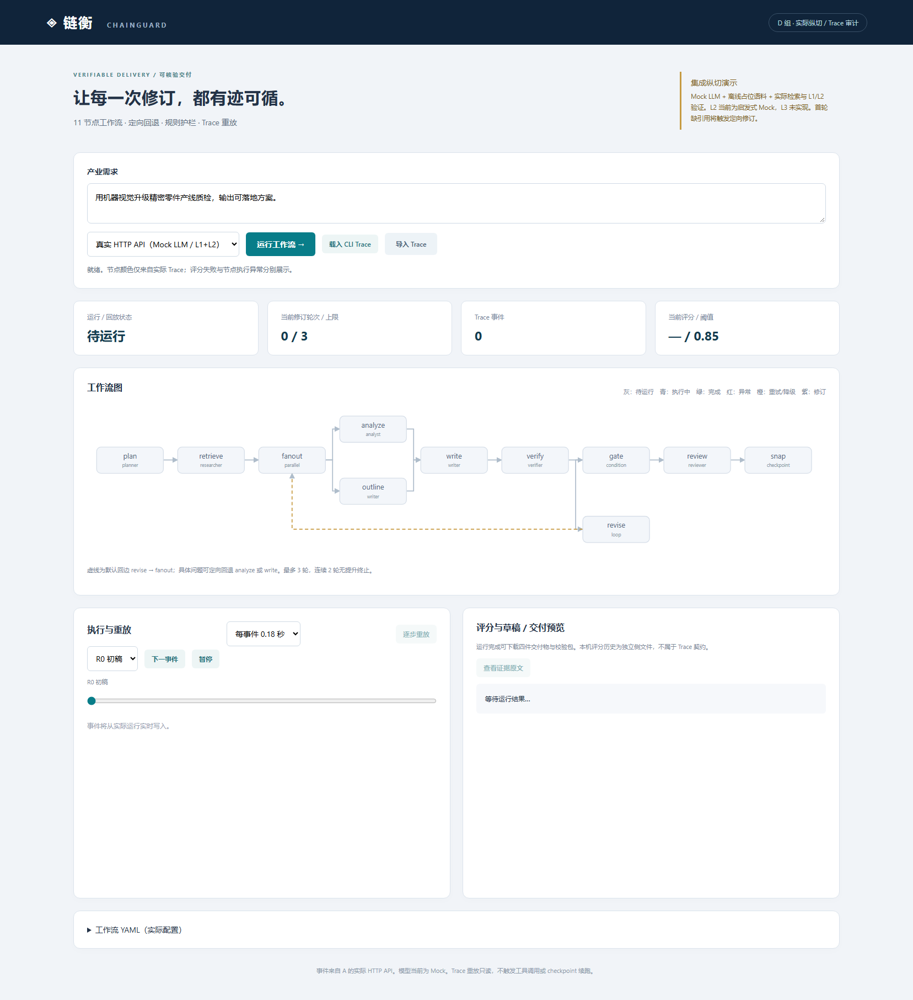
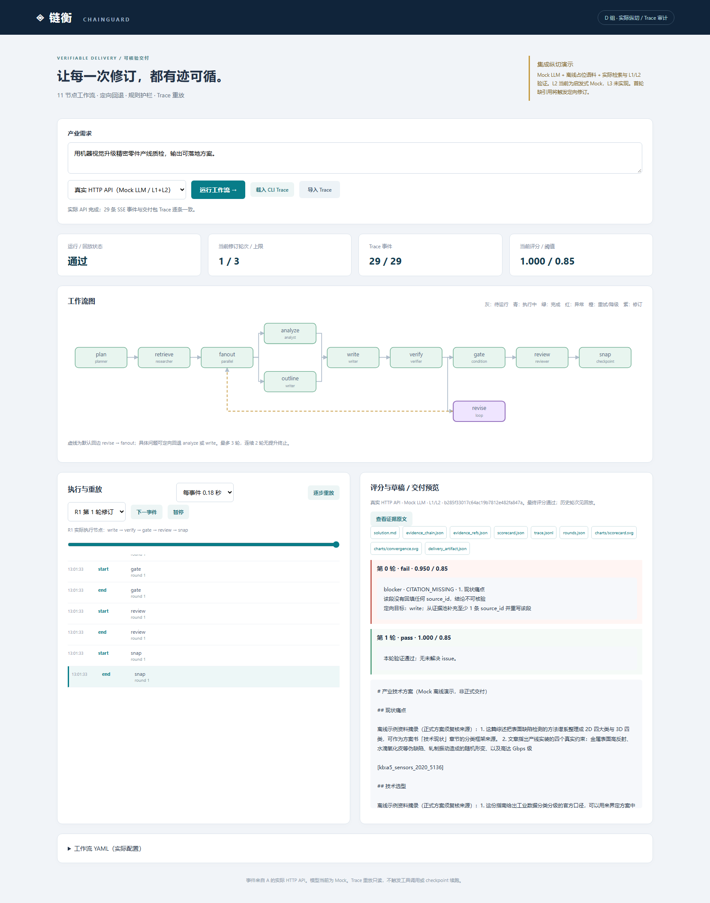

# 链衡 ChainGuard · 参赛方案书

> **赛题一：Agent 编排创新应用** ｜ 团队名称 / 学校 / 指导教师 / 演讲人：**按报名信息与 PPT 封面填写**（个人信息不写入公开仓库）
>
> 本文件为方案书正文源稿（Markdown）。按官方模板导出 PDF 后即为提交件。
> 全文所有数字均为 `main` 分支实测值，复算命令见第九章。

---

## 一、选题背景与场景需求分析

### 1.1 场景选择

我们选择的场景是：**中小制造企业的精密零件产线质检改造**——企业需要一份能用于立项与验收的
技术方案，而这份方案通常由人用两三周时间查标准、翻手册、找案例拼出来。

这个场景不是随手挑的。它同时具备三个特征：资料密集（国标、厂商手册、行业报告）、
结论必须有据（改造投入动辄数十万）、以及**错了代价高**（把不适用工艺写进方案，客户按图施工会返工）。

### 1.2 现状痛点

**痛点一：说不清结论怎么来的。**

一份改造方案里写着"不良品率可降 35%"，但没人能回答这个数字出自哪份文件、哪一年、什么口径。
技术负责人签字的依据是"看起来合理"，而不是"能对上原文"。

**痛点二：不敢用大模型写的东西。**

大模型能在几分钟内产出结构完整的方案，但里面的数字、标准号、引用往往没有出处，
甚至会把不存在的标准编号写得像真的。**"写得像"和"写得对"之间的差距，正是业务方不敢用的原因。**

**痛点三：看不到失败过程。**

多数 Agent 演示只给最终成功画面。中间改了几轮、哪一轮不合格、为什么回退、回退到哪个节点——
全部被剪掉。而真实工程里，**失败过程才是判断系统是否可靠的信息**。

### 1.3 需求归纳

| 角色 | 真实需求 | 对应平台能力 |
| --- | --- | --- |
| 方案撰写者 | 写出来的每句话都能回到出处 | 证据链：`evidence_refs.json` 记录文件/字符区间/原文/哈希 |
| 技术负责人 | 知道系统什么时候不可信 | 评分卡 + 一票否决 + 轮次留档（含 fail 轮） |
| 项目经理 | 交付物可验收、可复算 | manifest + 逐文件 sha256 + 一键复跑 |

### 1.4 与本赛题的契合

赛题一要求"面向多智能体协作的编排、调度、执行与验证平台"，考察六项能力：
知识库定义与集成、Agent 团队定义、工作流编排、动态调度、自我循环、结果验证与反馈。

**本项目六项能力一一对应，且每一项都有可运行的代码与可复算的数据**（见第三章、第七章）。

---

### 1.5 与常见方案的区别

| 维度 | 直接调用大模型 | 通用 Agent 框架 | **本项目** |
| --- | --- | --- | --- |
| 结论出处 | 无 | 通常无强制 | 每条结论必须带 `source_id`，可回原文 |
| 失败处理 | 重试到成功为止 | 抛异常或静默跳过 | **安全中止 + 完整 trace** |
| 过程可见 | 不可见 | 部分日志 | 每轮评分、阻断项、回退目标全部留档 |
| 接口约束 | 无 | 弱 | 11 份契约冻结，正反例齐全 |
| 复现成本 | 需要 API Key | 需要配环境与模型 | **零 Key、一条命令** |

差别不在"能不能生成"，而在**生成之后能不能被核对**。这也是我们把项目命名为
"链衡"的原因：链是引用链与事件链，衡是评分与阈值。

## 二、平台总体架构设计与技术选型说明

### 2.1 分层架构



> 图为矢量 SVG，由 `scripts/make_architecture_svg.py` 从仓库实读生成
> （契约 11 份、角色 6 类、语料 17 份、接口 3 个、端口 8000/8766 均为实读值），
> 并由 `tests/test_architecture_svg.py` 校验与代码一致——改代码不重出图，测试会红。

文字版（同一结构的精简表示）：

```
┌─────────────────────────────────────────────────────────┐
│  接入层   CLI（python -m src.run） / HTTP API（FastAPI）   │
│           控制台（Trace 重放、评分卡、证据查看）              │
├─────────────────────────────────────────────────────────┤
│  编排层   DAG 编译器 → 调度器（并发/超时/重试/降级/预算）      │
│           Loop 控制器（定向回退、轮次上限）                  │
├─────────────────────────────────────────────────────────┤
│  执行层   Agent 注册表（6 角色，YAML 声明，热加载）           │
│           工具层（检索、证据池、计算）                       │
├─────────────────────────────────────────────────────────┤
│  验证层   L1 规则验证（引用/数值/章节/Schema）               │
│           L2 独立评审（温度分离、一票否决）                  │
├─────────────────────────────────────────────────────────┤
│  产出层   交付包（9 件文件 + manifest + 逐文件 sha256）      │
└─────────────────────────────────────────────────────────┘
```

### 2.2 关键设计决策

**决策一：契约先行，且冻结。**

11 份 JSON Schema 定义模块间接口（`source_ref`、`retrieval_result`、`scorecard`、`compile_error`、
`agent_spec`、`workflow`、`trace_event`、`llm_response`、`task_state`、`delivery_artifact`、`draft`），
每份都配正例与反例。**2026-11-07 22:00 冻结为 tag `contracts-v1.0`**，之后任何 schema 变更必须走单独 PR。

理由：多 Agent 系统最常见的失败不是算法错，而是**模块间对同一个字段的理解不一致**
——上游写 `page: null`，下游当整数用，运行到一半才炸。契约冻结把这类问题挡在编译期。

**决策二：Mock 优先（Mock-first）。**

LLM 适配层有四档：DeepSeek / Qwen / Ollama / Mock。**Mock 是默认档，也是兜底档。**

理由：评审要复现，就不该要求评审去申请 API Key。当前全链路在 **零 Key** 下可完整跑通，
端到端 0.75 秒。真实模型走同一个接口，换档不改代码。

**决策三：验证分两层，第三层如实标注未实现。**

L1 是确定性规则（能给出 exact 判定），L2 是独立评审（温度与撰写者分离，避免同源偏差）。
L3（双路检索比对）**未实现**，配置里显式为 `false`，若手动改为 `true` 会直接报错退出——
**宁可启动失败，也不要假装做了。**

### 2.3 技术选型

| 层 | 选型 | 理由 |
| --- | --- | --- |
| 语言 | Python 3.11+ | 生态完整；评审环境最省事 |
| Web | FastAPI 0.162.0 + Pydantic v2 | 自动生成 OpenAPI；模型校验与契约一致 |
| 编排 | 自研 DAG 编译器 + LangGraph（可选） | 自研保证契约可控；LangGraph 作为执行后端之一 |
| 存储 | SQLite（失败样本库）+ 文件（交付包） | 零运维；评审直接可读 |
| 前端 | Vue3 + Vite（构建产物随仓库） | 无需 npm 即可打开控制台 |
| 部署 | Docker Compose | 一条命令起服务 |
| 测试 | pytest（333 项） | 与 CI 同一套命令 |

**依赖全部锁版本**（`requirements.txt` 20 个包逐条 pin），这是"可复现"评分项的基础。

---

### 2.4 数据模型与目录约定

平台把"一次运行"视为一等对象，所有产物按运行号归档，互不覆盖：

```
outputs/<run_id>/
├── solution.md              正文
├── evidence_chain.json      引用链
├── evidence_refs.json       逐条引用的定位信息
├── scorecard.json           终轮评分
├── rounds.json              全部轮次（含 fail）
├── trace.jsonl              事件流
├── charts/                  2 张 SVG
└── delivery_artifact.json   清单 + 逐文件 sha256
```

**为什么把 manifest 单独成文件**：交付物一旦离开仓库，唯一能证明"这九件是同一批产物"的
就是 manifest 里的 sha256。评审拿到包后可以逐文件重算，对不上就说明被改过。

契约文件与实现代码分开存放（`contracts/` 与 `src/`），是为了让"接口"可以脱离实现被审查：
11 份 schema 每份都配 `*.good.json` 与 `*.bad.json`，CI 会逐份校验正例通过、反例被拒。

### 2.5 部署形态与运行环境

三种运行方式，覆盖从"评审本机验证"到"线上服务"：

| 方式 | 命令 | 依赖 |
| --- | --- | --- |
| 单次运行（最轻） | `python -m src.run` | 仅 Python + 少量包 |
| 本地服务 | `uvicorn src.main:app` + `web.demo_server` | 加 fastapi/uvicorn |
| 容器化 | `docker compose up` | 仅 Docker |

**最小可验证路径刻意做得极轻**：不装前端依赖、不装 LangGraph、不要 API Key，
也能跑通纵切并产出九件交付物。这是为了让"复现"这件事不依赖任何评审没有的东西。

## 三、Agent 角色定义、工作流设计与编排逻辑详解

### 3.1 六类角色（YAML 声明）

| 角色 | 职责 | 工具白名单 | 只读 | 温度 |
| --- | --- | --- | --- | --- |
| planner | 拆解需求、确定分析路径 | 无 | ✅ | 0.2 |
| researcher | 检索知识库、产出候选证据 | search、fetch | ✅ | 0.3 |
| analyst | 定量分析、数值一致性检查 | calc | ✅ | 0.2 |
| writer | 撰写方案正文 | 无 | ❌ | **0.3** |
| verifier | 独立评审（L2） | 无 | ✅ | **0.0** |
| reviewer | 终审、一票否决 | 无 | ✅ | 0.0 |

**四个只读、两个可写**：写操作权限只给 `writer`，其余角色即使被注入恶意提示词也无法改文件。

**温度分离是刻意的**：撰写者 0.3（需要一定发散），评审者 0.0（要稳定复现）。
若两者温度相同，`verifier` 会拒绝启动——因为同源偏差会让"独立评审"名不副实。

### 3.2 注册表与热加载

`agent_registry.py` 对每份 YAML 计算 SHA256 内容指纹：

- 指纹变化即重新加载，**改配置不重启进程**；
- 加载时校验：schema 合法性、工具名是否在注册表中、只读角色是否配了写工具；
- 校验失败给出中文可读错误（不是裸 traceback）。

### 3.3 工作流：11 节点 DAG

```yaml
plan → retrieve → fanout → (analyze ∥ outline) → write → verify → gate → review → snap
                              ↑                                        │
                              └──────── revise（默认回边）─────────────┘
```

| 节点 | 类型 | 说明 |
| --- | --- | --- |
| plan | agent | planner 拆解需求 |
| retrieve | agent | researcher 检索，产出证据池 |
| fanout | parallel | 并行分支点 |
| analyze | agent | 定量分析 |
| outline | agent | 结构大纲 |
| write | agent | 撰写正文 |
| verify | verifier | L1+L2 验证，产出评分卡 |
| gate | condition | 分数/阻断项判定 |
| review | agent | 终审 |
| snap | checkpoint | 快照（可跳过） |
| revise | loop | 定向回退 |

### 3.4 编排逻辑的三条硬约束

**约束一：回边目标必须合法。**

评分卡里的 `target_node` 只能是 verify 的**合法前驱**。`LoopController` 会校验，
非法目标直接拒绝——防止"回退到一个根本没跑过的节点"这种静默错误。

**约束二：最多 3 轮，连续 2 轮无提升则终止。**

避免无限循环烧预算，也避免"越改越差"。

**约束三：条件边与并行边由编译器静态校验。**

`dag_compiler.py` 在启动前检查：无环、依赖存在、条件分支完整、并行汇合点唯一。
编译错误走 `compile_error` 契约，带 `code` 与中文 `hint`。

---

### 3.5 一段真实的工作流配置与它编译出的结果

```yaml
name: industry_solution
version: 0.1.0
nodes:
  - id: plan        { type: agent,  agent: planner,    depends_on: [] }
  - id: retrieve    { type: agent,  agent: researcher, depends_on: [plan] }
  - id: fanout      { type: parallel, depends_on: [retrieve] }
  - id: analyze     { type: agent,  agent: analyst,    depends_on: [fanout] }
  - id: outline     { type: agent,  agent: writer,     depends_on: [fanout] }
  - id: write       { type: agent,  agent: writer,     depends_on: [analyze, outline] }
  - id: verify      { type: verifier, depends_on: [write] }
  - id: gate        { type: condition, depends_on: [verify] }
  - id: review      { type: agent,  agent: reviewer,   depends_on: [gate] }
  - id: snap        { type: checkpoint, depends_on: [review] }
  - id: revise      { type: loop,   depends_on: [gate] }
```

编译器产出执行计划的同时做四类静态检查，任一不过即走 `compile_error`：

| 检查 | 反例 | 错误码 |
| --- | --- | --- |
| 依赖存在 | `depends_on: [not_exist]` | `MISSING_NODE` |
| 无环 | A→B→A | `CYCLE_DETECTED` |
| 角色已注册 | `agent: ghost` | `MISSING_AGENT` |
| 工具在白名单 | 只读角色配 `write_file` | `MISSING_TOOL` |

**把错误挡在编译期而不是运行期**，是多 Agent 系统能不能工程化的分水岭：
运行时才发现配置错，往往已经烧掉一轮预算。

## 四、调度算法与自我循环机制说明

### 4.1 调度器做了什么

| 机制 | 实现 | 可观测证据 |
| --- | --- | --- |
| 并发 | 并行分支用信号量控制同时执行数 | trace 中 `fanout` 后 analyze/outline 并发 start |
| 超时 | 单节点超时上限，超时即判 fail | `--inject-fault timeout` 可复现 |
| 重试 | 指数退避，最多 2 次 | trace 中 `retry` 事件 |
| 降级 | 重试耗尽后降级并**安全中止** | trace 中 `degrade` 事件，纵切不产出交付包 |
| 预算 | Token 预算护栏，超限即中止 | `task_state` 中的 budget 字段 |

**故障注入实测**（`python -m src.run --inject-fault timeout --node retrieve`）：

```
fail × 3   重试耗尽
retry × 2  重试两次
degrade × 7 降级传播
→ 安全中止，保留 trace.jsonl，不产出交付包
```

**"安全中止"是刻意的**：宁可不出包，也不出一个验证不过的包。这是本平台与"尽力而为"型
Agent 最大的区别——**失败也要留下可核验的记录**。

### 4.2 Self-Loop：定位到段落，只重跑相关节点

传统重试是整条重跑，代价高且会引入新的随机性。本平台的做法：

1. 验证不通过时，`verifier` 产出**结构化阻断项**（`code` + 具体段落 + 修订目标节点）；
2. `LoopController` 据此构造定向回退：只回退到 `write`，`retrieve`/`analyze` 的结果全部保留；
3. 重新评分，与上一轮比较。

**实测（控制台运行画面，见 6.4 截图）**：

```
第 0 轮 · fail · 0.950 / 0.85      ← 加权分已高于阈值
  blocker: CITATION_MISSING         ← 但一条阻断项触发一票否决
  该段没有回填任何 source_id，结论不可核验
  定向目标: write；从证据池补充至少 1 条 source_id 并重写该段

第 1 轮 · pass · 1.000 / 0.85
  本轮验证通过，无未解决 issue
```

这一例最能说明设计意图：**0.95 分看起来很好了，但缺一条引用就必须判 fail**。
如果只看加权分，这份方案会带着"没有出处的结论"交付出去。

### 4.3 一次运行的真实时序



这张图直接由 `trace.jsonl` 生成（29 个事件 / 2 轮 / 总跨度 117 ms），**不是示意图**：

- 灰色为**第 0 轮**（fail），绿色为**第 1 轮**（pass）；
- `verify` 单节点耗时 38.1 ms，是整个链路的瓶颈——因为它要跑 L1 五类规则 + L2 评审；
- `revise` 节点只出现在第 0 轮之后，**证明回退是定向的**：`retrieve` / `analyze` / `outline`
  在第 1 轮没有重跑，图上它们只有灰色条。

### 4.4 收敛控制

- 轮次上限 3；
- 连续两轮分数无提升 → 终止；
- 每轮评分、阻断项、修订目标全部写入 `rounds.json`（**包括 fail 的轮次**）。

---

## 五、结果验证策略与反馈优化逻辑

### 5.1 L1：确定性规则验证

`rule_checker.py` 检查五类问题，全部可复现、无随机性：

| 代码 | 检查内容 | 判定方式 |
| --- | --- | --- |
| `SCHEMA_INVALID` | 产物是否符合契约 | JSON Schema 校验 |
| `CITATION_MISSING` | 有结论但没有引用 | 段落级扫描 |
| `CITATION_UNKNOWN` | 引用了不存在的 `source_id` | 与证据池比对 |
| `NUMERIC_MISMATCH` | 正文数字与证据不一致 | 数值抽取 + 比对 |
| `MISSING_SECTION` | 缺必备章节 | 六个必需章节检查 |

### 5.2 L2：独立评审

- 与撰写者**温度不同**（0.0 vs 0.3），相同则拒绝启动；
- 替换 L1 的 `logic` 维度、追加 `LOGIC_*` 问题、按权重重算评分卡；
- 支持**一票否决**：任一阻断项存在即判 fail，无论加权分多高；
- 当前 Mock 模式下 L2 是**启发式实现**（bigram 重合、段落矛盾检测），不是真实模型——
  这一点在方案书与 PPT 里都明确标注。

### 5.3 评分卡

五维加权，总和 1.0；`pass_threshold = 0.85`，`metric_floor = 0.60`（任一维低于 0.60 即 fail）。

```json
{
  "run_id": "run-773c6d0145da",
  "round": 1,
  "score": 1.0,
  "threshold": 0.85,
  "metrics": { "citation": 1.0, "consistency": 1.0, "coverage": 1.0,
               "logic": 1.0, "format": 1.0 },
  "issues": [],
  "verdict": "pass"
}
```

### 5.4 证据链数据流



六跳：语料 → 切片 → 检索 → 证据池 → 引用 → 回查。每一跳都对应仓库里真实的文件或函数：

| 跳 | 实现 | 关键约束 |
| --- | --- | --- |
| ① 语料 | `knowledge/corpus/` 17 份 | 逐条登记许可依据，原创转述 |
| ② 切片 | `knowledge_hub.py` | 跳过 front-matter 与权利声明段（119 → 51 片） |
| ③ 检索 | BM25 + 向量 → RRF k=60 | `score` 是融合分，不是单路分 |
| ④ 证据池 | `evidence.py` | `source_id` 形如 `kb:x`，带原文与哈希 |
| ⑤ 引用 | `writer` 必须回填 | 缺失即 `CITATION_MISSING` |
| ⑥ 回查 | `evidence_refs.json` | 文件 / 字符区间 / 哈希，可逐字核对 |

**验证环**在 ⑤ 之后：L1 的五类规则逐条检查，命中区块则回到 ⑤ 定向重写——
这就是第四章 Self-Loop 的入口。

### 5.5 反馈优化：失败样本库

`feedback.py`（SQLite）：

- `record()` **幂等**写入（同一样本不会重复计入）；
- 样本 id 为内容 SHA256；
- `stats()` 按规则代码统计；
- `compare()` 前后对比，**自带样本量与"个案"声明**——样本少于 30 时只报个案，不报比率。

> 这条自律写进了实现：样本少就报比率，是被数据包装出来的可信感，我们不这么做。

---

### 5.5 评分权重与一票否决的具体规则

| 维度 | 权重 | 判定依据 |
| --- | --- | --- |
| citation（引用可回溯） | **0.30** | 引用覆盖率、引用能否回到原文 |
| consistency（一致性） | 0.20 | 数值与证据是否一致 |
| coverage（覆盖度） | 0.20 | 六个必备章节是否齐全 |
| logic（逻辑自洽） | 0.20 | L2 评审（Mock 下为启发式） |
| format（格式合规） | 0.10 | 模板与 Schema 合规（机器可判，故权重最低） |

计分口径：`score = Σ weights[k] × metrics[k]`，保留 3 位小数。

两条硬规则：

1. **一票否决**：任一 `blocker` 级问题存在 → `verdict = fail`，无论加权分多高；
2. **维度地板**：任一维低于 `metric_floor = 0.60` → 同样 fail。

第 0 轮 `0.950 / 0.85` 仍判 fail，就是第 1 条在起作用：
加权分只是"平均好不好"，阻断项回答的是"能不能交付"，两者不能互相抵消。

## 六、核心代码模块说明与系统截图

### 6.1 代码结构

```
src/
├── dag_compiler.py      DAG 编译与静态校验（无环/依赖/条件/并行）
├── scheduler.py         并发、超时、重试、降级、预算
├── loop_controller.py   定向回退与轮次控制
├── agent_registry.py    角色注册表（SHA256 热加载）
├── knowledge_hub.py     知识库切片与混合检索（BM25 + 向量，RRF k=60）
├── evidence.py          证据池与 source_ref 构造
├── rule_checker.py      L1 规则验证
├── verifier.py          L2 独立评审（温度分离、一票否决）
├── feedback.py          失败样本库（SQLite，幂等）
├── llm_adapter.py       四档 LLM 路由（DeepSeek/Qwen/Ollama/Mock）
├── vertical_slice.py    纵切：一次完整运行 → 9 件交付物
└── main.py              FastAPI 三接口
web/                     控制台（Vue3 构建产物 + Trace 重放 + 演示服务器）
contracts/               11 份 JSON Schema + 正反例
agents/                  6 份角色 YAML
configs/                 检索/验证/路由配置
tests/                   333 项测试
```

### 6.2 关键模块说明

**`dag_compiler.py`**：把 YAML 编译为可执行 DAG，并在**执行前**完成四类静态校验。
编译失败走 `compile_error` 契约（带 code 与中文 hint），而不是抛异常。

**`scheduler.py`**：调度策略是"按 DAG 拓扑 + 并发信号量 + 单节点超时 + 指数退避"。
故障注入可复现，是本项目"可验证"的基础设施。

**`knowledge_hub.py`**：切片时**跳过 YAML front-matter 与权利声明段**——
这使片段数从 119 降到 51，避免"版权/署名"类查询命中样板文字。

**`vertical_slice.py`**：一次运行产出 9 件交付物，全部登记进 manifest 并附 sha256。

### 6.3 系统截图一：控制台总览



界面自上而下：产业需求输入 → 运行模式选择（真实 HTTP API / Mock）→ 运行态指标
（状态、修订轮次、Trace 事件数、当前评分/阈值）→ 11 节点工作流图 → 执行重放与评分卡。

### 6.4 系统截图二：运行完成与定向修订



这张图是整个平台的自证：

- 运行态：**通过**、**1 / 3 轮**、**29 / 29 事件**、**1.000 / 0.85**；
- DAG 上 `revise` 节点被标为紫色（修订），可见定向回退确实发生过；
- 右侧评分卡同时列出 **第 0 轮 fail（0.950 / 0.85，blocker: CITATION_MISSING）**
  与 **第 1 轮 pass（1.000）**——失败轮没有被隐藏；
- 交付预览列出 9 件文件，可逐个查看证据原文。

### 6.5 交付物清单（9 件）

| 文件 | 作用 |
| --- | --- |
| `solution.md` | 方案正文 |
| `evidence_chain.json` | 引用了哪些 `source_id` |
| **`evidence_refs.json`** | 每条引用的文件 / 页码 / 字符区间 / 原文 / 哈希 |
| `scorecard.json` | 终轮评分卡 |
| **`rounds.json`** | 每轮评分，含首轮 fail |
| `trace.jsonl` | 全链路事件 |
| `charts/scorecard.svg` | 评分五维柱状图 |
| `charts/convergence.svg` | 收敛曲线（含 0.85 阈值线） |
| `delivery_artifact.json` | 交付清单与逐文件 sha256 |

---

## 七、测试用例、运行效果与性能评估

### 7.1 测试规模

| 维度 | 数值 |
| --- | --- |
| 测试总数 | **333 passed / 2 skipped** |
| 契约正反例 | 11 份 schema，逐份正反例校验 |
| 黄金用例 | 5 个（含 2 条中止路径） |
| 端到端纵切 | 通过，评分 1.000 |
| 容器验证 | Docker 构建 + 启动 + 接口冒烟（CI `container` job） |

### 7.2 黄金用例（可执行验收）

| 编号 | 场景 | 期望 |
| --- | --- | --- |
| G1 | 正常交付 | pass |
| G2 | 缺证据 → 定向修订后通过 | pass |
| G3 | 数值冲突 | 判 fail 并给出 `NUMERIC_MISMATCH` |
| G4 | 节点超时 | 降级安全中止（`blocked`） |
| G5 | 无法收敛 | 达上限中止（`blocked`） |

**两条中止路径（G4/G5）与三条成功路径同等重要**：能证明系统在异常时的行为是**确定的**。

### 7.3 性能评估

| 指标 | 实测值 | 说明 |
| --- | --- | --- |
| 端到端耗时（Mock） | **0.74 / 0.75 / 0.76 s**（三次） | 零 Key，单机 |
| 交付包体积 | 9 件文件 / **40.1 KB** | 含 2 张 SVG |
| 单测总耗时 | 约 19 s | 333 项 |
| 检索查询数 | 22 条（17 原文词 + 5 改述） | — |

**并发与压力测试未做**——那是决赛阶段的要求，我们不在初赛阶段虚构这部分数据。

### 7.4 检索效果（如实分列）

| 分组 | 查询数 | hit@8 | hit@1 | MRR |
| --- | --- | --- | --- | --- |
| 原文词 | 17 | 100% | 100% | 1.000 |
| **改述** | 5 | 100% | **40%** | 0.607 |
| 合计 | 22 | **100%** | 86.36% | 0.9106 |

**召回好、排序弱**：改述查询的 hit@1 只有 40%。这个结论对我们不利，但它是实测值——
用总体 100% 掩盖分组差异，就是在制造"看起来很好"的假象。

### 7.5 可复现性

```bash
python scripts/check.py            # 9 项检查 + 单测 + 端到端 + 纵切
python scripts/run_golden.py       # 5 个黄金用例
python -m src.knowledge_eval       # 检索命中率
python scripts/package_release.py  # 打包并解压复跑 check
```

- 依赖锁定（20 个包逐条 pin）；
- 零 API Key 可跑通全链路；
- 出包后**自动解压再跑一遍 check**，跑不过就删包。

---

### 7.6 CI 门禁与工程纪律

CI 与本地跑**完全同一套命令**（`make check`），没有第二套脚本——避免"本地过、CI 不过"的分裂。

| 门禁 | 内容 | 耗时 |
| --- | --- | --- |
| `check` job | 语法 → 契约 → 配置 → 单测 → 端到端 → 纵切 → HTTP 冒烟 | 约 35 s |
| `container` job | 真构建镜像 + 起容器 + 接口冒烟 | 约 60 s |
| 生成物守卫 | 仓库里出现生成物即失败（防止把产物当源码提交） | 含于 check |

另外三条自建的纪律检查：

- **归属覆盖**：每个一级目录必须在 `docs/owners.yaml` 登记 owner 与 backup，否则失败；
- **跨契约引用**：schema 之间引用的字段必须存在，防止契约漂移；
- **材料一致性**：测试报告里的数字与实测绑定，改代码不改报告会被测试拦下。

这些检查不增加功能，但直接对应评分表里的"文档质量"与"技术可靠性"——
**能把纪律做成可执行的门禁，比写在文档里靠自觉更可靠。**

## 八、人工智能使用说明

> 官方要求写明"各环节 LLM、RAG、MCP 等的实际作用、贡献与局限"。本章逐项说明，**包括没做的部分**。

### 8.1 LLM 在系统中的位置

| 环节 | LLM 是否参与 | 具体作用 | 局限 |
| --- | --- | --- | --- |
| 需求拆解（plan） | ✅ | 把自然语言需求拆成分析步骤 | Mock 下为规则模板 |
| 检索（retrieve） | ❌ | **不参与**：检索是 BM25+向量，确定性 | — |
| 定量分析（analyze） | ✅ | 数值抽取与一致性判断 | 数值仍以证据为准，LLM 不产出数字 |
| 撰写（write） | ✅ | 生成正文，必须带 `source_id` | Mock 下由模板拼接，不编造内容 |
| 验证（verify L1） | ❌ | **不参与**：规则校验，无随机性 | — |
| 验证（verify L2） | ✅ | 独立评审逻辑自洽性 | **Mock 下是启发式**（bigram/矛盾检测），非真实模型 |
| 反馈（feedback） | ❌ | **不参与**：SQLite 统计 | — |

**关键设计：凡是要"判定"的地方，尽量不交给 LLM。**
L1 全是确定性规则；L2 才用模型，且温度 0.0、与撰写者分离。

### 8.2 RAG 的作用边界

- 知识库：**17 份原创转述卡**，不是真实行业原文；
- 检索：BM25 + 向量双路，RRF（k=60）融合；
- 作用：为每条结论提供可回到原文的依据；
- **局限一**：语料是转述卡，覆盖度有限；
- **局限二**：改述查询 hit@1 仅 40%，排序是短板；
- **局限三**：页码仅对 PDF/DOCX 有效；当前 Markdown 语料 `page` 为 `null`，
  靠 `file_path + char_range + hash` 回原文。**PDF 页码贯通未用真实文件验证。**

### 8.3 工具与外部集成

- 工具注册表 + 白名单：每个角色只能调用声明的工具；
- 只读约束：四个只读角色即使被注入也无法写文件；
- **MCP 未接入**——赛题提到 MCP/Function Calling/API 插件三种方式，我们实现的是
  "工具注册 + 白名单 + HTTP 适配"这一路径，**没有实现 MCP 协议**。

### 8.4 AI 贡献与人工判断的分界

| 环节 | 由 AI 完成 | 由人完成 |
| --- | --- | --- |
| 检索与证据组织 | ✅ | 语料编写与许可判定 |
| 方案撰写 | ✅ | 场景设定与验收标准 |
| 规则验证 | — | ✅ 规则由人定义，机器执行 |
| 独立评审 | ✅（启发式） | ✅ 阈值与权重设定 |
| 是否交付 | ❌ | ✅ **系统只给判定，最终交付由人决定** |

### 8.5 我们刻意没做的事

1. **没有为了让演示好看而隐藏失败轮次**：`rounds.json` 保留 fail 轮；
2. **没有把第三层验证写成已完成**：配置显式 `false`，设为 `true` 会拒绝启动；
3. **没有用总体指标掩盖分组差异**：改述 hit@1 40% 单独列出；
4. **没有接入真实模型却宣称"已接入"**：Mock 为默认档，四档路由可切换；
5. **没有做压测却宣称支撑大规模并发**：明确写"未做"。

---

## 九、复现与附录

### 9.1 环境与复现

```bash
# 1) 安装依赖（已锁版本）
python -m pip install -r requirements.txt

# 2) 一条命令验证全部
python scripts/check.py

# 3) 生成示例交付包
python -m src.run --output outputs/demo

# 4) 启动控制台
python -m uvicorn src.main:app --port 8000 &
python -m web.demo_server --port 8766 --api-base http://127.0.0.1:8000
# 浏览器打开 http://127.0.0.1:8766
```

**全程不需要任何 API Key。**

### 9.2 基线数据（2026-11-11，`main`）

| 项 | 值 |
| --- | --- |
| 仓库文件数 | 186 |
| 测试 | 333 passed / 2 skipped |
| 契约 | 11 份 |
| 语料 | 17 份（原创转述卡） |
| 角色 | 6 类 |
| DAG 节点 | 11 |
| 交付物 | 9 件 / 40.1 KB |
| 端到端 | 0.75 s（Mock） |

### 9.3 已知限制汇总

| 项 | 现状 |
| --- | --- |
| L3 双路检索比对 | 未实现，配置显式 false |
| 检索排序 | 改述查询 hit@1 40% |
| L2 判定 | Mock 下为启发式 |
| 页码贯通 | 代码路径已通，未用真实 PDF 验证 |
| 语料性质 | 转述卡，非原始资料 |
| MCP | 未接入 |
| 并发压测 | 未做（决赛阶段要求） |
| 演示第三轮 | 故障注入回放，不代表自然跑三轮 |

### 9.5 关于局限的说明

把这些限制逐条列出来，不是为了显得谦虚，而是因为**它们是评审继续追问的入口**。
一个项目如果宣称"全都做完了"，评审只能问"真的吗"；如果主动交代边界，
评审会问"那你们打算怎么解决"——后者是更有价值的对话。

我们更希望被记住的是：**这份方案自己会说自己哪里不行。**

### 9.4 团队分工与协作机制

| 角色 | 负责 | 主要交付 |
| --- | --- | --- |
| 队长（架构与调度） | 接口、调度器、LLM 路由、容器化 | FastAPI 三接口、四档路由、Docker |
| 知识库与工具 | 语料、检索、证据链、测试与材料 | 17 份语料、混合检索、交付包与文档 |
| Agent 与验证 | 角色配置、L1/L2 验证、反馈库 | 6 份角色 YAML、规则验证器、样本库 |
| 编排与前端 | DAG 编译、Loop、控制台、演示 | 编译器、定向回退、Trace 重放界面 |

协作机制不靠口头约定，而是三条可执行的门禁：

1. **契约冻结**：接口变更必须单独提 PR 并说明影响面；
2. **单一命令验收**：`make check` 一个命令跑完九项检查，CI 与之完全一致；
3. **作者不自合**：所有改动经 PR 与人工复核进入主干。

**分工的价值不在"谁写了哪一行"，而在"出问题时能定位到谁、以及他留下了什么证据"。**
